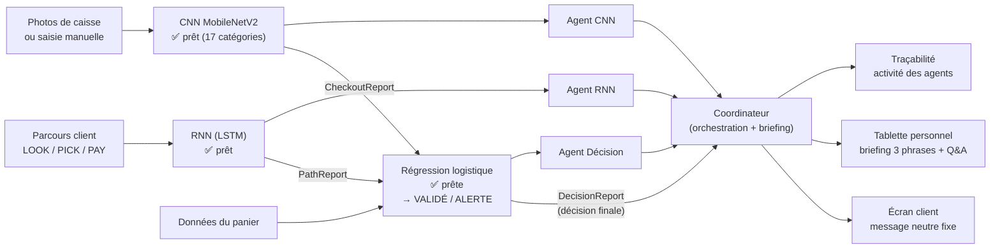

# 🛒 TrustCart – Plateforme de Caisse Autonome sans Friction

> **ING4 Data Mining – Projet 20 : Smart Retail**  
> Système de validation automatisée de paniers d'achat en caisse autonome et détection d'anomalies (dissimulation, rafle, vol).

---

## 1. Vue d'ensemble de l'architecture

Le système repose sur un découpage strict en quatre couches : **Perception & Modèles**, **Décision Déterministe**, **Agents spécialisés**, et **Coordination / Interface**.



### Principes éthiques et techniques fondamentaux :
- **Les modèles statistiques décident, les agents expliquent** : la régression logistique produit 100 % des décisions `VALIDÉ` / `ALERTE`. Les agents LLM (RNN, CNN, Décision, Coordinateur) ne peuvent ni modifier ni contourner cette décision.
- **Communication séparée** : l'écran client affiche un message strictement neutre et factuel. Seul le personnel reçoit les briefings explicatifs détaillés et les réponses aux questions.
- **Routage multi-agents** : une question du personnel est dirigée vers l'agent spécialiste compétent (parcours → Agent RNN, articles/vision → Agent CNN, seuil/fusion → Agent Décision), puis synthétisée par le Coordinateur si plusieurs domaines sont concernés.
- **Résilience (Zero Crash)** : si l'API Gemini est inaccessible (quota, réseau, absence de clé), chaque agent bascule automatiquement sur des gabarits français hors ligne. `AGENT_MODE=templates` force ce mode pour les démos sans réseau.

---

## 2. Installation & Démarrage rapide

### Prérequis
- Linux ou macOS (ou WSL2 sur Windows)
- **Python 3.13** (requis pour la compatibilité TensorFlow / Keras 3.13)
- Gestionnaire de paquets `uv` (recommandé) ou `venv` standard

### 1. Cloner le projet et créer l'environnement

```bash
# Cloner le dépôt
git clone https://github.com/abdelhak0999/TrustCart.git
cd TrustCart

# Créer l'environnement virtuel avec Python 3.13
uv venv --python 3.13 .venv-app
# OU avec python standard : python3.13 -m venv .venv-app

# Installer les dépendances
.venv-app/bin/pip install -r requirements.txt
```

### 2. Configuration des secrets (`.env`)

Copiez le modèle d'environnement :
```bash
cp .env.example .env
```

Éditez le fichier `.env` pour y renseigner votre clé gratuite Google AI Studio :
```ini
GEMINI_API_KEY=AIzaSy...votre_cle_ici
GEMINI_MODEL=gemini-3.8-flash
AGENT_BACKEND=gemini
```
*(Note : Si vous ne disposez pas de clé API, laissez vide. L'application utilisera automatiquement les templates hors ligne).*

### 3. Lancer la démonstration Streamlit

```bash
.venv-app/bin/streamlit run app/app.py
```
L'interface est accessible sur [http://localhost:8501](http://localhost:8501).

---

## 3. Guide d'intégration pour l'équipe (Où brancher vos modules)

### A. Reconnaissance Produits (CNN / Vision) — ✅ intégrée
- **Dataset** : Kaggle `diyer22/retail-product-checkout-dataset` (RPC), 17 supercatégories.
- **Artefacts** : `models/cnn/cnn_model.keras`, `models/cnn/cnn_meta.json`, `models/cnn/sample_crops/`.
- **Fichier** : `app/trustcart/cnn.py`
  - `items_seen(manual_item_ids, image_paths=None, manual_categories=None)` retourne un `CheckoutView` avec `source="cnn"`, la confiance moyenne et les catégories reconnues.
  - **Important** : le modèle Keras exporté contient déjà les couches `preprocess_input` (`true_divide` / `subtract`). Il faut donc lui fournir des pixels RGB bruts `[0, 255]`, sans réappliquer `mobilenet_v2.preprocess_input`.
  - Le CNN reconnaît des **catégories larges**, pas les identifiants `itemid` du catalogue : les `item_ids` du panier restent la source de vérité pour le total et les articles non présentés. Aucune table de correspondance inventée n'est utilisée.

### B. Fusion & Décision (Régression Logistique) — ✅ intégrée
- **Données d'entraînement** : `models/rnn/rnn_scores.parquet` (score RNN calibré + split officiel) et `outputs/rnn_v5/sessions_labeled.parquet` (événements bruts pour dériver les features de caisse).
- **Features** (voir `app/trustcart/decision.py`) :
  1. `rnn_risk` : score RNN calibré [0, 1].
  2. `items_picked_not_presented` : articles pris en rayon mais absents de la caisse.
  3. `cart_total` : valeur des articles présentés.
  4. `visit_duration_min` : durée de la visite.
  5. `items_rejected_by_cnn` : articles déclarés que le CNN n'a pas confirmés sur la photo de caisse (fraude par substitution). Vaut 0 en mode manuel (sans caméra).
  - **Simulation de la caméra (v3)** : les sessions d'entraînement n'ont pas de photos de caisse. La caméra est donc simulée dans chaque split (graine fixe) : bruit honnête au taux d'erreur mesuré du CNN (0,58 %), et 5 % des sessions honnêtes clonées avec 1 ou 2 articles substitués (label 1, motif `substitution`).
  - `cnn_confidence` n'est **pas** une feature : aucune photo de caisse n'existe pour les sessions d'entraînement, la confiance réelle du CNN ne peut donc pas être apprise honnêtement. Le CNN agit sur la décision via les articles présentés et les articles rejetés ; sa confiance est affichée au personnel.
- **Protocole zéro fuite** : `scripts/train_decision.py` ajuste le scaler et le modèle sur `train`, choisit le seuil d'alerte sur `val` (meilleur F1), puis évalue une seule fois sur `test`. Les métriques et coefficients sont exportés dans `models/decision/decision_meta.json`.
- **Reproductibilité** : le ré-entraînement nécessite `outputs/rnn_v5/sessions_labeled.parquet`, produit par le notebook RNN (`notebooks/rnn.ipynb`) et non versionné (trop volumineux). L'application et les scripts de vérification n'en ont pas besoin : ils utilisent uniquement les artefacts de `models/`.
- **Inférence** : `app/trustcart/decision.py::_logistic_regression()` applique exactement les mêmes coefficients, le même scaler et le même seuil ; `LOGISTIC_REGRESSION_AVAILABLE = True`.

### C. Agents explicatifs (multi-agents) — ✅ intégrés
- **Stack** : LangGraph uniquement (pas de LangChain). Chaque agent est un `StateGraph` `infer/decide → narrate` ; le coordinateur orchestre un graphe de passage en caisse (RNN ∥ CNN → Décision → briefing) et un graphe Q&A (routage par LLM — repli sur mots-clés si hors ligne ou réponse invalide — → `Send` vers les spécialistes → synthèse). Les appels LLM passent par le client `openai` (endpoints compatibles Gemini / Ollama).
- **Package** : `app/trustcart/agents/`
  - `rnn_agent.py` → `PathReport` (risque, indices, pause, fiabilité).
  - `cnn_agent.py` → `CheckoutReport` (articles posés, manquants, confiance, état de la vision).
  - `decision_agent.py` → `DecisionReport` (décision finale, features, raison).
  - `coordinator.py` → orchestration LangGraph parallèle, écran client neutre, briefing 3 phrases, routage Q&A.
- **Modes** (`AGENT_MODE`) : `hybrid` (défaut), `full_llm`, `templates`.
- **Garantie** : aucun agent ne peut modifier `DecisionReport.decision.outcome`.

---

## 4. Organisation du projet

```
Projet/
├── README.md                  ← Ce document
├── requirements.txt           ← Dépendances de l'application (Python 3.13)
├── .env.example               ← Modèle des variables d'environnement
├── .gitignore                 ← Configuration Git (exclut les secrets et données lourdes)
│
├── app/                       ← Application Streamlit et cœur TrustCart
│   ├── app.py                 ← Point d'entrée de la démo (Coordinateur + traçabilité agents)
│   ├── data/demo_sessions.json← 5 sessions réelles du jeu de test (normal, vol, fausse alerte)
│   └── trustcart/             ← Logique métier et interfaces des modèles
│       ├── config.py          ← Configuration, backends et modes des agents
│       ├── rnn.py             ← Inférence du parcours client (LSTM)
│       ├── cnn.py             ← Inférence CNN MobileNetV2 (17 catégories)
│       ├── decision.py        ← Régression logistique déterministe (VALIDÉ / ALERTE)
│       ├── visit.py           ← Traduction des événements en indices factuels (français)
│       ├── agent.py           ← Ancien agent unique (compatibilité)
│       └── agents/            ← Architecture multi-agents
│           ├── base.py        ← Contrats communs + fallback LLM zero-crash
│           ├── rnn_agent.py   ← Agent RNN → PathReport
│           ├── cnn_agent.py   ← Agent CNN → CheckoutReport
│           ├── decision_agent.py ← Agent Décision → DecisionReport
│           ├── coordinator.py ← Orchestration, briefing, routage Q&A
│           └── facts.py       ← Faits autorisés + message client neutre
│
├── models/                    ← Artefacts de modèles
│   ├── rnn/                   ← Modèle LSTM entraîné et métadonnées
│   │   ├── rnn_model.keras    ← Modèle Keras 3.13
│   │   ├── rnn_meta.json      ← Métriques, seuil d'alerte (0.476), calibration Platt
│   │   ├── rnn_scores.parquet ← Base pour l'entraînement de la régression logistique
│   │   └── item_prices.csv    ← Grille tarifaire unifiée par article
│   ├── cnn/                   ← MobileNetV2 entraîné (RPC, 17 supercatégories)
│   │   ├── cnn_model.keras
│   │   ├── cnn_meta.json
│   │   └── sample_crops/      ← 17 vignettes de test vérifiées
│   └── decision/              ← Régression logistique exportée
│       ├── decision_meta.json ← Coefficients, scaler, seuil, métriques val/test
│       └── decision_features.parquet ← Audit des features et probabilités par split
│
├── scripts/                   ← Outils reproductibles
│   ├── train_decision.py      ← Entraînement zéro fuite de la régression logistique
│   ├── verify_agents.py       ← Vérification hors ligne des agents, du routage et du fallback
│   ├── check_generalization.py← Métriques train / val / test des 3 modèles (surapprentissage)
│   ├── simulate_case.py       ← Simulation d'un passage en caisse (normal / vol) en ligne de commande
│   └── run_all_checks.sh      ← Lance toutes les vérifications
│
├── notebooks/                 ← Expérimentations Jupyter / Kaggle
│   ├── rnn.ipynb              ← Pipeline complet du RNN (80 cellules, phases 0 à 14)
│   ├── cnn.ipynb              ← CNN v2 (MobileNetV2, anti-surapprentissage)
│   └── cnn_v1/                ← Première version du CNN (notebook, modèle, classes), conservée pour l'historique
│
├── kaggle/                    ← Notebooks et métadonnées des kernels Kaggle (rnn/, cnn/)
│
└── context/                   ← Documentation métier et fiches de présentation
```

---

## 5. Performances et métriques actuelles

### RNN — risque du parcours
- **Architecture** : Embeddings + LSTM (64 unités) avec masquage Keras 3 sans fuite temporelle.
- **Calibration** : Régression de Platt (ECE ramenée de 0.044 à 0.004).
- **Seuil d'alerte RNN** : `0.476` sur le score calibré.
- **Test** : PR-AUC `0.966` (4 seeds : `0.967 ± 0.003`), ROC-AUC `0.996`, précision `91.7 %`,
  rappel `87.2 %`, fausses alertes `0.74 % ± 0.19`.

### CNN — reconnaissance des produits
- **Architecture** : MobileNetV2 (ImageNet) en transfer learning + fine-tuning (50 dernières couches), 17 supercatégories RPC. Notebook : `kaggle/cnn/cnn.ipynb` (v2).
- **Données** : 67 120 vignettes d'entraînement (59 130 de caisse = 80 % des images `val2019`, + 7 990 vignettes plateau équilibrées par classe) ; validation 14 471 vignettes (20 % des images `val2019`) ; test 9 771 vignettes issues de 800 images `test2019` entières, jamais vues. Découpage **par image** (aucune fuite).
- **Anti-surapprentissage** : augmentations (rotations 90°, flips, zoom, couleur), label smoothing 0.1, AdamW, dropout 0.4, poids de classes, early stopping sur `val_loss`, LR cosinus ; calibration par température (T = 0.41) intégrée au modèle exporté.
- **Résultats** : train `99.46 %` / val `99.47 %` / test `99.42 %` (macro-F1 test `0.9937`, ECE `0.002`). Écart train − test : `+0.04 pt` → pas de surapprentissage. La v1 avait train ≈ 99 % / test 59 %.
- **Limite** : RPC est un ensemble fermé (les mêmes 200 produits dans tous les splits) : le test mesure la reconnaissance de produits connus sur de nouvelles photos de caisse, pas la généralisation à de nouveaux produits.
- **Figures** : `models/cnn/courbes_apprentissage_cnn.png`, `models/cnn/matrice_confusion_cnn.png`.

### Régression logistique — décision finale
- **Protocole** : fit sur `train` (23 643 sessions, dont les clones de substitution), seuil choisi sur
  `val` (5 069), évaluation unique sur `test` (5 069).
- **Features** : `rnn_risk`, `items_picked_not_presented`, `cart_total`, `visit_duration_min`,
  `items_rejected_by_cnn`.
- **Seuil d'alerte** : `0.5` (meilleur F1 sur validation).
- **Validation** : F1 `0.9077`, PR-AUC `0.9441`, ROC-AUC `0.9944`.
- **Test** : F1 `0.8960`, PR-AUC `0.9372`, ROC-AUC `0.9944`, précision `90.5 %`, rappel `88.7 %`,
  fausses alertes `1.10 %`. Train / val / test très proches (F1 `0.904` / `0.908` / `0.896`) → pas de
  surapprentissage.
- **Rappel par type de fraude (test)** : alibi `93.6 %`, dissimulation `82.1 %`, rafle `83.3 %`,
  substitution `100 %`. Sans les clones de substitution : F1 `0.876`, précision `88.7 %`, rappel `86.5 %`.
- **Transparence** : la v1 utilisait un proxy de confiance CNN (hash des articles, sans lien avec le
  label) : coefficient ≈ 0.05, et décalage avec la vraie confiance du CNN en inférence. Il a été retiré
  et remplacé (v3) par `items_rejected_by_cnn`, qui correspond exactement à ce que fait l'application.
