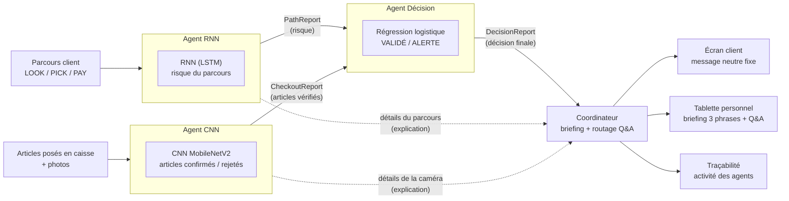

# 🛒 TrustCart – Caisse autonome sans friction

> **ING4 Data Mining – Projet 20 : Smart Retail**
> Validation automatique des paniers en caisse autonome et détection d'anomalies (dissimulation, achat alibi, rafle, substitution d'article).

TrustCart suit un client de son entrée en magasin jusqu'au paiement. Trois modèles se partagent le travail :

- un **RNN (LSTM)** analyse la séquence d'actions en rayon et donne un **score de risque du parcours** ;
- un **CNN (MobileNetV2)** reconnaît les produits posés en caisse et vérifie qu'ils correspondent aux articles déclarés ;
- une **régression logistique** combine ces signaux et décide : **VALIDÉ** ou **ALERTE**.

Des **agents LLM** (LangGraph) expliquent ensuite cette décision au personnel. Ils ne peuvent jamais la modifier.

---

## Sommaire

1. [Démarrage rapide](#1-démarrage-rapide)
2. [Utiliser la démo](#2-utiliser-la-démo)
3. [Architecture](#3-architecture)
4. [Les modèles](#4-les-modèles)
5. [Les agents](#5-les-agents)
6. [Scripts et vérifications](#6-scripts-et-vérifications)
7. [Organisation du dépôt](#7-organisation-du-dépôt)
8. [Ré-entraîner les modèles](#8-ré-entraîner-les-modèles)
9. [Dépannage](#9-dépannage)

---

## 1. Démarrage rapide

### Prérequis

| Élément | Version / remarque |
|---|---|
| Système | Linux, macOS ou Windows (WSL2 recommandé) |
| Python | **3.13** (TensorFlow 2.21 ne supporte pas encore Python 3.14) |
| Git | Pour cloner le dépôt |
| Espace disque | ~2 Go pour l'environnement (TensorFlow inclus) |
| Clé API Gemini | **Facultative**. Sans clé, l'application fonctionne avec des réponses hors ligne. |

Tous les modèles entraînés sont **déjà inclus dans le dépôt** (`models/`). Aucun jeu de données ni entraînement n'est nécessaire pour lancer la démo.

### Installation

```bash
git clone https://github.com/abdelhak0999/TrustCart.git
cd TrustCart
```

Créez l'environnement virtuel avec Python 3.13 :

```bash
python3.13 -m venv .venv-app
```

> Avec [uv](https://docs.astral.sh/uv/), l'équivalent est `uv venv --python 3.13 .venv-app`.

Installez les dépendances :

```bash
.venv-app/bin/pip install -r requirements.txt
```

> **Windows (PowerShell, hors WSL)** : remplacez `.venv-app/bin/` par `.venv-app\Scripts\` dans toutes les commandes, par exemple `.venv-app\Scripts\pip install -r requirements.txt`.

### Configuration (`.env`)

```bash
cp .env.example .env
```

Le fichier `.env` est lu au démarrage. Les variables principales :

| Variable | Rôle | Valeur par défaut |
|---|---|---|
| `GEMINI_API_KEY` | Clé gratuite [Google AI Studio](https://aistudio.google.com) (bouton *Get API key*). Laisser vide pour le mode hors ligne. | vide |
| `GEMINI_MODEL` | Modèle Gemini utilisé par les agents | `gemini-3.8-flash` |
| `AGENT_BACKEND` | `gemini`, `ollama` ou `templates`. Vide : Gemini si une clé est présente, sinon gabarits. | vide |
| `AGENT_MODE` | `hybrid`, `full_llm` ou `templates` (voir [§5](#5-les-agents)) | `hybrid` |
| `OLLAMA_URL`, `OLLAMA_MODEL` | Pour utiliser un LLM local via [Ollama](https://ollama.com) à la place de Gemini | `http://localhost:11434/v1`, `llama3.1:8b` |

### Lancer l'application

```bash
.venv-app/bin/streamlit run app/app.py
```

L'interface s'ouvre sur [http://localhost:8501](http://localhost:8501). Le premier chargement prend quelques secondes (chargement de TensorFlow et des modèles).

Pour une démo **sans réseau ni clé API** :

```bash
AGENT_MODE=templates .venv-app/bin/streamlit run app/app.py
```

### Vérifier l'installation

```bash
.venv-app/bin/python scripts/verify_agents.py
```

Le script doit se terminer par `ALL CHECKS PASSED`. Il fonctionne sans clé API ni réseau.

---

## 2. Utiliser la démo

L'écran est organisé en 4 sections.

1. **Parcours du client** : la séquence d'événements de la visite (`Regarde`, `Prend`, `Paie`), avec le rayon, le prix et le délai entre chaque action.
2. **Passage en caisse** : les articles posés sur le plateau. Chaque article est photographié et classé par le CNN. On peut couper la caméra (saisie manuelle) ou simuler une substitution.
3. **Résultat** : l'écran client (message neutre), la tablette du personnel (briefing) et les signaux des modèles. L'encadré *Activité des agents* détaille le travail de chaque agent.
4. **Questions au personnel** : un chat où chaque question est envoyée à l'agent spécialiste concerné.

### Les 5 scénarios (menu de gauche)

Ce sont de vraies sessions du jeu de test.

| Scénario | Ce qui se passe | Résultat attendu |
|---|---|---|
| **Client normal** | Prend 3 articles, les présente et les paie | ✅ VALIDÉ |
| **Dissimulation** | Prend un article à 164,61 €, s'arrête 26 min, ne le présente pas | 🔴 ALERTE |
| **Achat alibi** | Garde un article à 179,55 € et ne paie qu'un petit article | 🔴 ALERTE |
| **Rafle** | Prend 5 articles en quelques secondes dans le même rayon | 🔴 ALERTE |
| **Fausse alerte** | Client honnête que le RNN juge suspect (risque 98 %) | 🔴 ALERTE (à tort) : montre les limites du modèle et l'intérêt d'une vérification humaine |

### Manipulations à montrer

- **Retirer un article** de la liste *Articles posés en caisse* : le nombre d'articles non présentés augmente et la probabilité d'anomalie monte.
- **Simuler une substitution** (expander dans la section 2) : déclarer un article mais poser un produit d'une autre catégorie. Le CNN rejette l'article et la décision en tient compte.
- **Couper la caméra CNN** : le système passe en saisie manuelle et continue de fonctionner.
- **Poser des questions** : *« Pourquoi cette alerte ? »*, *« Quels articles manquent ? »*, *« Quelle est la pause la plus longue ? »*, *« Le modèle est-il fiable ? »*, *« Comment aborder le client ? »*. Sous chaque réponse, une ligne indique l'agent qui a répondu et la source du texte (LLM ou gabarit).

---

## 3. Architecture

Principe : **les modèles décident, les agents expliquent.**



- **Flèches pleines** : le chemin de la décision. Le risque RNN et les articles vérifiés par le CNN alimentent la régression logistique, qui tourne dans l'Agent Décision.
- **Flèches pointillées** : les rapports détaillés des agents RNN et CNN servent uniquement à **expliquer** (briefing, réponses aux questions). La régression ne reçoit que 5 valeurs numériques ; le coordinateur a besoin du détail (chronologie, pauses, photo par photo) pour répondre au personnel.

### Déroulement d'un passage en caisse

Le coordinateur exécute un graphe LangGraph :

```
START → visit → (rnn_agent ∥ cnn_agent) → decision_agent → briefing → END
```

1. **visit** : les événements bruts sont résumés (articles pris et payés, durée, pause la plus longue, indices de vol).
2. **rnn_agent** et **cnn_agent** tournent **en parallèle** : risque du parcours d'un côté, vérification des articles par la caméra de l'autre.
3. **decision_agent** attend les deux, calcule les 5 features et applique la régression logistique.
4. **briefing** : le coordinateur produit le message client (fixe) et le briefing du personnel.

### Principes de conception

- **Décision déterministe** : la régression logistique produit 100 % des décisions. Aucun agent ne peut modifier `DecisionReport.decision.outcome`.
- **Communication séparée** : le client voit un message neutre et fixe, jamais accusateur. Seul le personnel reçoit les explications.
- **Faits contrôlés** : les agents ne reçoivent qu'un dictionnaire de faits issus des modèles (`agents/facts.py`) et n'ont pas le droit d'en inventer.
- **Zéro crash** : si le LLM est indisponible (pas de clé, quota, réseau), chaque agent bascule automatiquement sur des gabarits en français.

---

## 4. Les modèles

Tous les artefacts sont dans `models/` et sont chargés une seule fois au démarrage.

### RNN : risque du parcours (`app/trustcart/rnn.py`)

- **Données** : sessions e-commerce RetailRocket transformées en parcours en magasin (`LOOK` / `PICK` / `PAY`), avec des vols simulés selon 3 motifs : dissimulation, achat alibi, rafle.
- **Architecture** : embeddings + LSTM (64 unités), masquage Keras 3 sans fuite temporelle.
- **Calibration** : régression de Platt (ECE ramenée de 0,044 à 0,004). Seuil d'alerte : `0,476`.
- **Test** : PR-AUC `0,966` (4 seeds : `0,967 ± 0,003`), ROC-AUC `0,996`, précision `91,7 %`, rappel `87,2 %`, fausses alertes `0,74 % ± 0,19`.
- **Notebook** : `notebooks/rnn.ipynb`.

### CNN : reconnaissance des produits (`app/trustcart/cnn.py`)

- **Données** : Kaggle `diyer22/retail-product-checkout-dataset` (RPC), 17 supercatégories.
- **Architecture** : MobileNetV2 (ImageNet) en transfer learning + fine-tuning des 50 dernières couches. Calibration par température (T = 0,41) intégrée au modèle exporté.
- **Données d'entraînement** : 67 120 vignettes d'entraînement, 14 471 de validation, 9 771 de test issues de 800 images jamais vues. Découpage **par image** (aucune fuite).
- **Anti-surapprentissage** : augmentations, label smoothing 0,1, AdamW, dropout 0,4, poids de classes, early stopping, LR cosinus.
- **Résultats** : train `99,46 %` / val `99,47 %` / test `99,42 %` (macro-F1 test `0,9937`, ECE `0,002`). La v1 (conservée dans `notebooks/cnn_v1/`) avait 99 % en train et 59 % en test.
- **Limite** : RPC est un ensemble fermé (les mêmes 200 produits dans tous les splits). Le test mesure la reconnaissance de produits connus sur de nouvelles photos, pas la généralisation à de nouveaux produits.
- **Utilisation dans l'application** :
  - chaque article du catalogue reçoit une catégorie RPC par une règle fixe (`itemid % 17`), car RetailRocket ne fournit pas de catégories ;
  - la caméra est simulée : chaque article posé est photographié avec une vignette de test vérifiée de sa catégorie (`models/cnn/sample_crops/`) ;
  - un article déclaré n'est **confirmé** que si le CNN reconnaît sa catégorie avec une confiance ≥ 60 %. Sinon il est **rejeté**.
  - Le modèle exporté contient déjà le prétraitement MobileNetV2 : il reçoit des pixels RGB bruts `[0, 255]`.
- **Notebook** : `notebooks/cnn.ipynb` (v2).

### Régression logistique : décision finale (`app/trustcart/decision.py`)

| Feature | Description | Coefficient |
|---|---|---|
| `rnn_risk` | Risque calibré du parcours (RNN) | 2,42 |
| `items_rejected_by_cnn` | Articles déclarés que le CNN n'a pas confirmés (substitution) | 0,97 |
| `visit_duration_min` | Durée de la visite | 0,13 |
| `items_picked_not_presented` | Articles pris en rayon mais non confirmés en caisse | 0,13 |
| `cart_total` | Montant des articles confirmés | 0,07 |

- **Protocole sans fuite** (`scripts/train_decision.py`) : ajustement sur `train` (23 643 sessions), seuil choisi sur `val` (5 069, meilleur F1), évaluation unique sur `test` (5 069).
- **Seuil d'alerte** : `0,5`.
- **Test** : F1 `0,896`, PR-AUC `0,937`, ROC-AUC `0,994`, précision `90,5 %`, rappel `88,7 %`, fausses alertes `1,10 %`. Train / val / test très proches (F1 `0,904` / `0,908` / `0,896`) : pas de surapprentissage.
- **Rappel par type de fraude (test)** : alibi `93,6 %`, dissimulation `82,1 %`, rafle `83,3 %`, substitution `100 %`.
- **Simulation de la caméra** : les sessions d'entraînement n'ont pas de photos. La caméra est donc simulée dans chaque split (graine fixe) : bruit au taux d'erreur mesuré du CNN (0,58 %), et 5 % de sessions honnêtes clonées avec 1 ou 2 articles substitués (label 1).
- **Pourquoi la confiance du CNN n'est pas une feature** : sans vraies photos de caisse dans les données d'entraînement, elle ne peut pas être apprise honnêtement. Le CNN agit sur la décision via les articles confirmés et rejetés ; sa confiance est seulement affichée au personnel.

---

## 5. Les agents

Package : `app/trustcart/agents/`. Chaque agent est un graphe LangGraph `calcul → narration`. Les appels LLM passent par le client `openai` (endpoints compatibles Gemini et Ollama).

| Agent | Fichier | Rôle | Rapport produit |
|---|---|---|---|
| Agent RNN | `rnn_agent.py` | Calcule et explique le risque du parcours (pauses, rythme, indices) | `PathReport` |
| Agent CNN | `cnn_agent.py` | Vérifie les articles avec la caméra, explique ce qui a été vu ou rejeté | `CheckoutReport` |
| Agent Décision | `decision_agent.py` | Applique la régression logistique, explique les facteurs principaux | `DecisionReport` |
| Coordinateur | `coordinator.py` | Orchestre le passage en caisse, écrit le briefing, route les questions | `CheckoutResult` |

Fichiers communs : `base.py` (client LLM et repli sur gabarits), `facts.py` (faits autorisés et message client fixe).

### Questions du personnel

```
START → route → Send(rnn_qa | cnn_qa | decision_qa)* → synthesise → END
              └→ coordinator_qa → END
```

Le routeur (LLM, avec repli par mots-clés) envoie chaque question au bon spécialiste : parcours → Agent RNN, articles et caméra → Agent CNN, seuil et fiabilité → Agent Décision, conduite à tenir → Coordinateur. Si plusieurs spécialistes répondent, le coordinateur fusionne leurs réponses.

### Modes de narration (`AGENT_MODE`)

Chaque agent peut produire son texte de deux façons : par le **LLM** (génératif) ou par un **gabarit** (texte à trous rempli avec les chiffres des modèles). Les faits et la décision sont identiques dans les deux cas ; seule la formulation change.

| Mode | Résumés des agents spécialistes | Briefing du coordinateur | Réponses aux questions |
|---|---|---|---|
| `templates` | gabarit | gabarit | gabarit |
| `hybrid` (défaut) | gabarit | LLM | LLM |
| `full_llm` | LLM | LLM | LLM |

Quel que soit le mode, une erreur du LLM fait basculer l'agent sur son gabarit.

---

## 6. Scripts et vérifications

Tous les scripts se lancent depuis la racine du dépôt.

| Commande | Rôle |
|---|---|
| `.venv-app/bin/python scripts/verify_agents.py` | Vérification hors ligne : les 5 scénarios, la décision jamais modifiée par un agent, la cohérence de la régression, le CNN, le routage et le repli sur gabarits |
| `.venv-app/bin/python scripts/simulate_case.py conceal` | Simule un passage en caisse en ligne de commande et affiche chaque étape. Scénarios : `normal`, `conceal`, `alibi`, `spree`, `false_alarm`. Options : `--mode hybrid`, `--swap <catégorie>` |
| `.venv-app/bin/python scripts/check_generalization.py` | Compare les métriques train / val / test du RNN et de la régression (surapprentissage) |
| `bash scripts/run_all_checks.sh` | Lance toutes les vérifications et écrit le résultat dans `test_report.txt` |

---

## 7. Organisation du dépôt

```
TrustCart/
├── README.md
├── requirements.txt            Dépendances (Python 3.13)
├── .env.example                Modèle de configuration (copier en .env)
│
├── app/
│   ├── app.py                  Interface Streamlit (point d'entrée)
│   ├── data/demo_sessions.json 5 sessions réelles du jeu de test
│   └── trustcart/
│       ├── config.py           Chemins et configuration des agents
│       ├── visit.py            Résumé lisible d'une visite et indices de vol
│       ├── rnn.py              Inférence du RNN
│       ├── cnn.py              Inférence du CNN et vérification du panier
│       ├── decision.py         Régression logistique (VALIDÉ / ALERTE)
│       ├── agent.py            Ancien agent unique (conservé pour compatibilité)
│       └── agents/             Architecture multi-agents (voir §5)
│
├── models/
│   ├── rnn/                    LSTM, encodeurs, calibration, scores par session
│   ├── cnn/                    MobileNetV2, métadonnées, 17 vignettes de test
│   └── decision/               Coefficients, scaler, seuil, métriques
│
├── scripts/                    Entraînement de la décision et vérifications (voir §6)
├── notebooks/                  Notebooks d'entraînement du RNN et du CNN (v2, et v1 dans cnn_v1/)
├── kaggle/                     Versions Kaggle des notebooks et métadonnées des kernels
└── context/                    Énoncé, fiches des modèles et scénarios métier
```

---

## 8. Ré-entraîner les modèles

Ce n'est **pas nécessaire** pour lancer la démo.

- **RNN** : exécuter `notebooks/rnn.ipynb` (ou sa version Kaggle `kaggle/rnn/`). Il produit les artefacts de `models/rnn/` et le fichier `outputs/rnn_v5/sessions_labeled.parquet`.
- **CNN** : exécuter `notebooks/cnn.ipynb` (ou `kaggle/cnn/`) sur le jeu RPC. Il produit `models/cnn/cnn_model.keras` et `cnn_meta.json`.
- **Régression logistique** : nécessite `outputs/rnn_v5/sessions_labeled.parquet`, produit par le notebook RNN et non versionné (trop volumineux).

  ```bash
  .venv-app/bin/python scripts/train_decision.py
  ```

  Les coefficients, le scaler, le seuil et les métriques sont écrits dans `models/decision/decision_meta.json`.

---

## 9. Dépannage

| Problème | Solution |
|---|---|
| `pip` ne trouve pas `tensorflow-cpu==2.21.*` | Vérifier que l'environnement utilise Python 3.13 : `.venv-app/bin/python --version` |
| Les réponses des agents sont des gabarits alors qu'une clé est configurée | La ligne *Source* sous la réponse indique la raison (quota, clé refusée, réseau). Vérifier `GEMINI_API_KEY` et `GEMINI_MODEL` dans `.env`. |
| Démo sans Internet | Lancer avec `AGENT_MODE=templates` |
| Messages `oneDNN` ou `absl` au démarrage | Messages d'information de TensorFlow, sans conséquence |
| Le port 8501 est occupé | `.venv-app/bin/streamlit run app/app.py --server.port 8502` |
